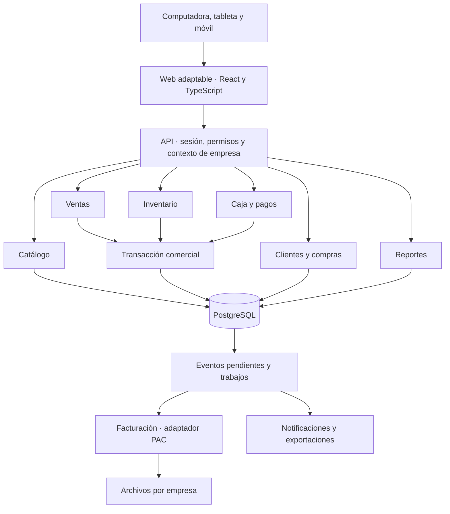

# Arquitectura inicial de POINT

**Estado:** base de la Fase 02 implementada localmente. Basada en las secciones 3, 35, 39–48 y 58 del documento maestro. Los dominios comerciales del diagrama se incorporan por fases; todavía no están implementados.

## Implementado en 02

React/TypeScript/Vite en `apps/web`, FastAPI en `apps/api`, PostgreSQL con Alembic y base interna de outbox. OpenAPI genera los tipos de `packages/shared`; no se duplican manualmente esos contratos. Lifespan libera el pool; los endpoints de salud comprueban conexión y revisión de migración. La configuración funciona tanto en el árbol del repositorio como al empaquetar la API por separado.

Los valores de instalación usan variables de entorno. La configuración por empresa, versionada y autorizada, llegará con el módulo tenants; tendrá prioridad sobre los valores iniciales para cada cliente. Las reglas de impuestos/stock/fees siguen sus fases y nunca se cambian solo en la pantalla.

Se conserva el diseño 01 como página separada de demostración. No hay persistencia comercial, autenticación, worker ejecutando tareas ni integraciones externas en esta base. Docker/Compose/CI están definidos; ejecución de contenedores pendiente. Evidencia y límites en [la revisión](docs/phases/02-base-tecnica/REVISION.md).

## Organización

Frontend independiente con React/TypeScript y API en Python/FastAPI como monolito modular, con SQLAlchemy/Alembic y PostgreSQL. Los módulos comparten una transacción cuando participan en una venta. Redis y almacenamiento compatible con S3 se incorporarán al necesitar caché, colas o archivos; no serán la fuente única de operaciones comerciales.



Las flechas representan las responsabilidades del producto final. Actualmente funcionan web, API de sistema, PostgreSQL y outbox interno; los demás dominios permanecen planificados.

## Límites de módulos

- **auth/tenants:** identidad, membresía, contexto autorizado, sucursales y permisos. Ningún módulo acepta cambiar de empresa mediante un campo del cliente sin comprobar membresía.
- **catalog:** productos, variantes, códigos, impuestos y precios vigentes. Entrega reglas; ventas conserva snapshots.
- **inventory:** dueño de balances y movimientos. Todas las variaciones pasan por sus servicios transaccionales.
- **sales:** coordina confirmación, descuentos, snapshots, folios y ticket. No implementa llamadas a un PAC o una marca de terminal.
- **cash/payments:** turnos y efectivo físico, pagos aplicados, referencias y reembolsos; servicios mínimos en 06, controles completos en 07.
- **customers/purchases/returns/promotions:** datos y flujos propios; efectos sobre stock/pagos se solicitan a los módulos responsables.
- **billing/platform:** documentos fiscales y cobros POINT son dominios distintos; cada uno conserva sus estados e historial.
- **reports:** consultas de lectura con permisos. Exportaciones largas se ejecutan en segundo plano.
- **audit/jobs/integrations:** auditoría, tareas durables, notificaciones y adaptadores. Se incorporan con cada funcionalidad que los necesite.

Cada módulo separará rutas/esquemas, servicios de aplicación, reglas y acceso a datos. Evitar que rutas o pantallas actualicen directamente balances o estados de pagos.

## Contexto autorizado

Después de autenticar se determina usuario, membresía de empresa activa y alcances. El servidor valida que sucursal, almacén, caja y recursos relacionados pertenezcan al mismo contexto. Las tareas posteriores y las descargas conservan y vuelven a validar ese alcance.

Propuesta de defensa: filtros obligatorios en repositorios, referencias compuestas en PostgreSQL y evaluación de RLS en 03. Si se habilita RLS, el contexto será local a la transacción, con rol de aplicación sin privilegios de omisión; probar también su comportamiento con el pool de conexiones.

## Confirmación de venta

1. Autenticar y validar permiso, empresa, sucursal y caja abierta.
2. Reclamar una clave idempotente única por empresa/operación y comprobar la huella del contenido.
3. Leer productos/precios/impuestos autorizados; recalcular cantidades, descuentos y totales en decimal.
4. Bloquear sesión y balances necesarios en orden estable; validar existencias y política.
5. Crear venta y líneas con snapshots de precio/costo/impuestos/descuentos y folio único.
6. Registrar pagos y movimiento de efectivo neto cuando corresponda; aplicar movimientos/balances de inventario.
7. Crear fee solo si hay regla comercial activa; cuando el módulo 11 exista, integrar snapshot y ajuste en la transacción.
8. Registrar auditoría, respuesta idempotente y eventos posteriores durables.
9. Confirmar la transacción. Si falla una operación crítica, revertir todos esos efectos.

La impresión, envío y facturación parten de la venta confirmada y pueden reintentarse. La pérdida de respuesta después del commit se resuelve consultando/reintentando la misma clave, conservada por el cliente.

La Fase 06 inicialmente registra efectivo y cobros realizados externamente. Capturar dinero en una pasarela no puede incluirse dentro de la transacción de PostgreSQL: una integración futura usará estados de pago, referencias idempotentes, conciliación y compensación explícita; no mantendrá bloqueada la base durante una llamada al proveedor.

## Trabajos y eventos

Proponer una tabla de eventos pendientes/outbox escrita junto con la transacción comercial. Un worker obtiene tareas, registra intento/estado, aplica backoff y mueve fallos persistentes a revisión. Los consumidores son idempotentes porque la entrega puede repetirse. Notificaciones/webhooks no son requisito para conservar una venta.

Usar credenciales de prueba y datos ficticios al integrar. Para proveedores reales se confirmarán servicio, cuenta, alcance y parámetros en la fase correspondiente.

## Sin conexión

El primer POS comercial confirma con el servidor. Desde el diseño se reservan UUID de operación, dispositivo y caja. La Fase 13 agrega caché/cola local con estados pendientes, sincronización y conflictos según política de la empresa. No se usa un stock cacheado como garantía de existencia global.

## Estructura prevista desde la Fase 02

```text
apps/
  web/
  api/
packages/
  shared/
infrastructure/
  docker/
  scripts/
docs/
  phases/
tests/
```

Los esquemas API/OpenAPI serán la fuente de contratos; evitar duplicar manualmente reglas de cálculo en web y API. El cliente puede mostrar una estimación, que se reconcilia con el cálculo autorizado del servidor.

## Decisiones por validar

Tecnología propuesta antes de 02; precisión/redondeo y costo antes de 04–06; RLS y política de sesión en 03; estrategia de trabajos al habilitar integraciones; PAC/terminal en sus fases; infraestructura y capacidad antes del piloto. El desarrollo mantendrá migraciones, documentación y pruebas al ampliar el modelo.
