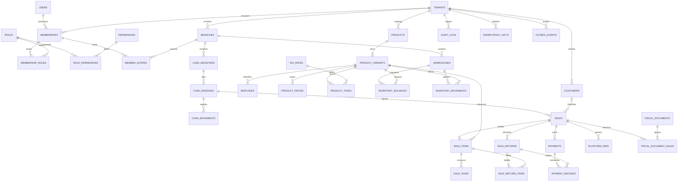

# Modelo de datos inicial

**Estado:** modelo conceptual completo y primera migración de infraestructura aplicada en Fase 02. Las entidades comerciales se crean por fase con migraciones versionadas.

## Esquema efectivamente implementado

Revisión `20261028_0001`: `outbox_events` con UUID, tenant_id obligatorio, clave de operación, tipo, payload JSONB, estado, intentos y fechas con zona. Restricción única `(tenant_id, operation_key)`, validación de estado/intentos e índice parcial de pendientes. Alembic conserva `alembic_version`.

El servicio interno enqueue participa en la transacción de su llamador y no hace commit ni envíos. Los tenants reales y su FK se crean en 03 antes de usar eventos de comercios; todavía no hay API pública de eventos ni de negocio. Esta estructura no equivale a aislamiento SaaS ya implementado.

Se comprobaron migración y reversión en esquema desechable, rollback, unicidad por empresa y restauración de un evento ficticio. Desarrollo usa `point_dev`, pruebas `point_test` y recuperación bases nuevas `point_restore_*`; el usuario de aplicación no es superusuario. El resto del ERD siguiente permanece como diseño de las fases posteriores.

Fuente: secciones 10–28 y 37–42 del documento maestro. Este modelo detalla el núcleo; el resto del catálogo de tablas se incorpora sin perder sus relaciones de empresa.

## Diagrama del núcleo

Es una vista parcial: cada relación operativa debe preservar empresa y alcance aunque el diagrama no dibuje todas las aristas a TENANTS. Las cardinalidades describen registros confirmados cuando aplica. Una variante predeterminada permite que un producto sin atributos use el mismo flujo de inventario y venta.

## Entidades principales y campos propuestos

| Grupo | Datos relevantes | Integridad prevista |
| --- | --- | --- |
| tenants / tenant_settings | nombre, país, moneda, zona, estado, políticas versionadas | Políticas de stock/pricing no se interpretan desde constantes de la UI |
| users / memberships | identidad global, hash, estado; vínculo usuario–empresa | UNIQUE tenant_id/user_id; roles se asignan a membresía, no al usuario global |
| roles / permissions / membership_roles / member_scopes | plantilla, acción y límites de sucursal/almacén/caja | FKs de misma empresa; negar por defecto |
| sessions | usuario/membresía activa, hash de identificador, expiración, revocación | Recuperación y MFA con datos protegidos, no tokens en claro |
| branches / warehouses | empresa, clave, nombre, ubicación y estado | Claves internas únicas por empresa; almacén pertenece a su sucursal |
| products / product_variants / barcodes | tipo, nombre, categoría, unidad, inventariable, SKU, atributos y códigos | SKU/código únicos por empresa; referencias a variante de la misma empresa |
| product_prices / product_cost_history | variante, lista, valor, vigencia, anterior, responsable y motivo | Historial sin sobrescribir ventas anteriores |
| taxes / tax_rates / product_taxes | tipo, tratamiento, tasa decimal, vigencia, incluido/excluido | No confundir exento con tasa cero; snapshots separados en venta |
| inventory_balances | empresa, almacén, variante, cantidad, costo promedio y versión | UNIQUE tenant_id/warehouse_id/variant_id; actualización bajo transacción |
| inventory_movements | tipo, cantidad firmada, antes/después, costo, documento origen, actor, motivo y fecha | Movimiento inmutable; reverso explícito; balance concilia con movimientos |
| cash_registers / cash_sessions | sucursal, caja, operador, estado, fondo y apertura/cierre | Índice único parcial para una sesión abierta por caja |
| cash_movements / cash_closings | sesión, tipo, efectivo neto, origen; esperado, contado y diferencia | Una entrada por efecto de origen; un cierre efectivo por sesión |
| sales / sale_items | empresa/sucursal/caja, folio, estado, cliente opcional, totales; cantidad y snapshots | Folio único por empresa/sucursal/serie; FKs tenant + alcance |
| sale_taxes / sale_discounts | línea/venta, regla/versiones, base, tasa y monto | Cálculos históricos independientes del catálogo vigente |
| payment_methods / payments | venta, método, importe aplicado, recibido/cambio, estado, referencia externa | Importe aplicado positivo y saldo conciliado en transacción; nunca datos completos de tarjeta |
| sale_returns / sale_return_items | venta, estado, motivo, autorización; línea, cantidad, condición y destino | Cantidad acumulada ≤ vendida, validada con bloqueo por línea |
| payment_refunds | devolución, pago original, importe, método y referencia | Reembolso acumulado ≤ pago; idempotencia de proveedor si aplica |
| customers / customer_tax_profiles | nombre/contacto mínimo; perfil fiscal separado | Cliente opcional; datos necesarios según operación |
| platform_fees / fee_adjustments | venta, regla, base, tasa, monto, estado; devoluciones relacionadas | Valores históricos y ajustes; separación del fee de terminal |
| fiscal_documents / fiscal_document_sales | estado, proveedor, identificador fiscal, archivos; ventas/importe asignado | Relación explícita para factura individual o global; bloquear doble asignación activa |
| audit_logs | actor, empresa/alcance, acción, entidad, motivo, antes/después sanitizados, fecha | Solo inserción por app; no secretos ni cambios destructivos ordinarios |
| idempotency_keys | empresa, operación, clave, huella, estado y referencia/respuesta | UNIQUE tenant_id/operation/key; conflicto si cambia contenido |
| outbox_events / background_jobs | empresa, evento, entidad, payload mínimo, estado e intentos | Evento escrito con la operación; consumo idempotente |

## Tipos y convenciones

- UUID para identidades públicas; folios comerciales separados del identificador técnico.
- `NUMERIC(18,2)` para importes monetarios finales; proponer `NUMERIC(18,6)` para precio/costo unitario y cantidad, y `NUMERIC(12,8)` para tasas. Precisiones finales y límites por unidad se cierran en 04.
- Fecha/hora en `TIMESTAMPTZ`, con registro temporal normalizado y presentación/rangos de negocio según zona configurada.
- `created_at`, `updated_at` y actor cuando corresponda. Archivo lógico para catálogo; operaciones confirmadas se revierten, nunca desaparecen.
- Contratos JSON representan dinero y cantidades decimales como cadenas para evitar pérdida por coma flotante.
- Para auditoría/históricos se permiten snapshots JSON sanitizados; las relaciones y montos críticos conservan columnas e integridad relacional.

## Aislamiento e índices

1. Incluir `tenant_id` en entidades operativas y validar el contexto autenticado.
2. Tener clave candidata `(tenant_id, id)` en padres y FKs compuestas desde hijos; por ejemplo una línea no referencia una variante de otra empresa.
3. Preservar además coherencia de sucursal/almacén/caja mediante claves compuestas o validación transaccional explícita. Pertenecer a la misma empresa no autoriza cualquier sucursal.
4. Índices propuestos: ventas `(tenant_id, branch_id, created_at)`; movimientos `(tenant_id, warehouse_id, variant_id, created_at)`; códigos `(tenant_id, code)`; sesiones abiertas por caja; auditoría `(tenant_id, entity_type, entity_id, created_at)`; trabajos por estado/fecha de reintento.
5. Las sumas de pagos/devoluciones y límites entre filas requieren transacción/bloqueo; un CHECK aislado no comprueba un agregado de otras filas.
6. RLS será defensa adicional si se adopta y prueba en 03. No reemplaza permisos ni FKs.

## Ampliaciones previstas

- **05:** inventory_adjustments/items, stock_counts/items y stock_transfers/items, incluida mercancía en tránsito y recepciones.
- **08:** suppliers, supplier_products, purchase_orders/items, goods_receipts/items, purchases/items y supplier_returns.
- **09:** customer_addresses/tags/notes, promociones/versiones, sale_status_history y datos completos de reembolso.
- **10:** fiscal_profiles, fiscal_document_items/events, fiscal_provider_requests, global_invoice_batches/items y relaciones de elegibilidad.
- **11:** plans, subscriptions, pricing_rules, settlements/items y billing_events.
- **13:** devices, sync_operations, notifications, webhook_endpoints/deliveries e integration_credentials protegidas.

La lista maestra de la sección 42 permanece como referencia; estas ampliaciones no son tablas ya creadas ni contratos de migración definitivos.

## Migraciones

La primera migración se creó y probó en 02. Cada módulo añade cambios compatibles y versionados; no editar retrospectivamente una migración aplicada para cambiar una base existente. Probar instalación vacía y actualización. Los catálogos de ejemplo usan datos ficticios sin contraseñas/credenciales fijas. Restaurar copias en ambiente aislado antes de aplicar cambios arriesgados en producción.
