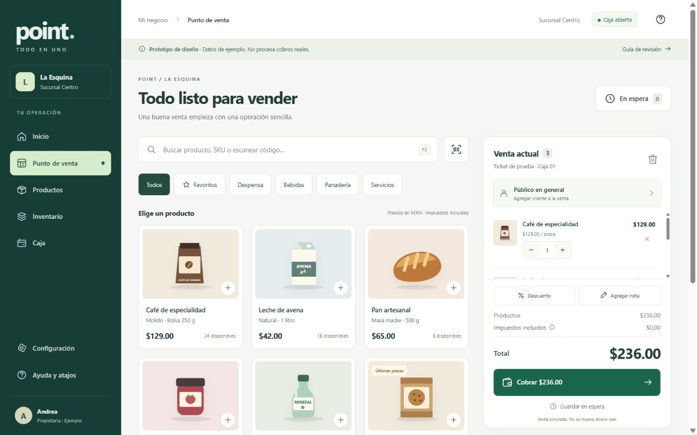
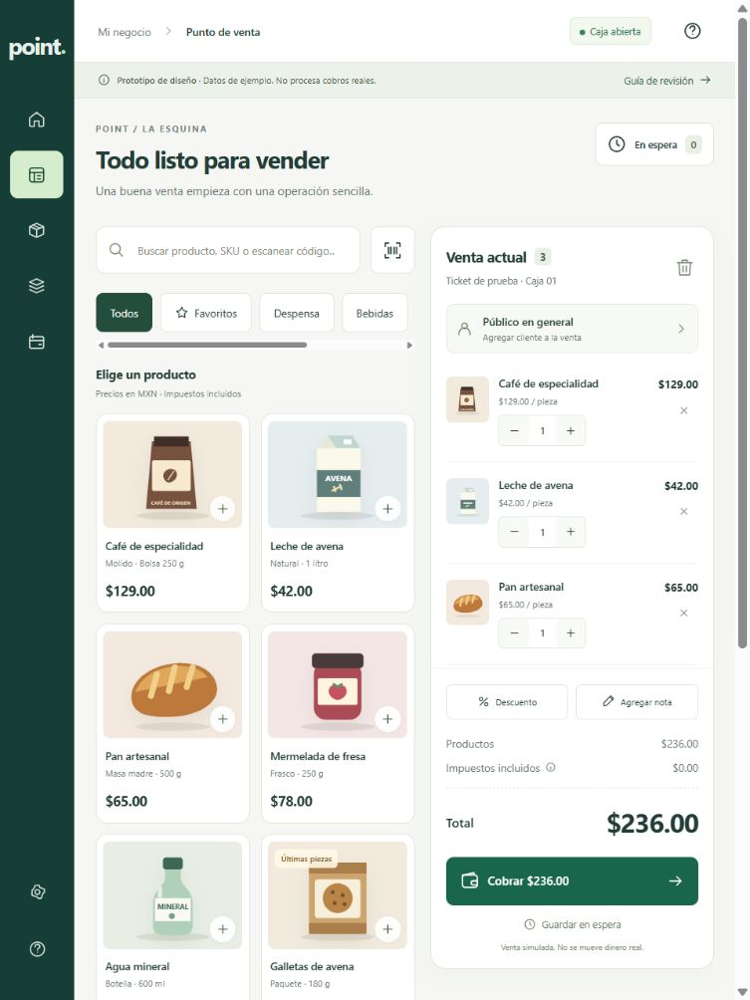
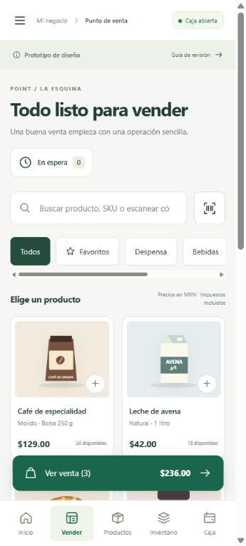
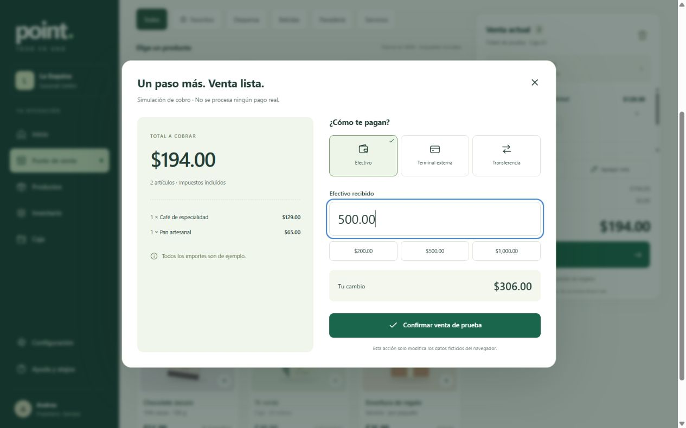
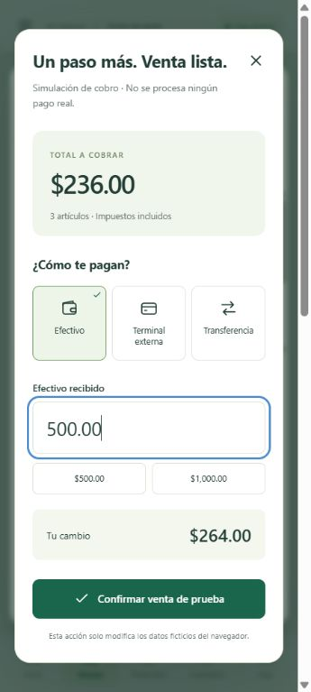

# Segunda parte para revisar · Fase 01

**Entrega:** diseño y prototipo navegable de POINT.

**Estado:** diseño aprobado por el usuario el 28 de octubre de 2026: «El diseño me parece bien». Se autorizó continuar con la Fase 02 y ajustar los parámetros por cliente en futuras entregas.

## 1. Resumen

Se creó una interfaz de POINT con seis áreas principales y sus ventanas de operación: Inicio, Punto de venta, Productos, Inventario, Caja y Configuración inicial. Incluye cobro, ticket, alta/edición de producto, ajustes con motivo, ventas en espera y cierre de caja con diferencia.

**Todo usa datos ficticios. No procesa cobros, emite facturas ni crea cuentas reales.** Los cambios de demostración permanecen solo en este navegador; pueden reiniciarse desde Guía de revisión.

## 2. Arquitectura

El prototipo se conserva separado en `prototypes/phase-01`. HTML/CSS/JavaScript locales permiten revisar el diseño sin instalar paquetes. El archivo único incorpora sus estilos, ilustraciones y scripts. El sistema real se implementará con la arquitectura aprobada a partir de la Fase 02.

Ver [sistema visual](DESIGN_SYSTEM.md) y [estructura/recorridos](WIREFRAMES.md).

## 3. Base de datos

No aplica en esta fase visual. Se usa almacenamiento del navegador para ejemplos. No hay PostgreSQL, tablas ni migraciones implementadas. Este almacenamiento no es una solución comercial ni garantiza aislamiento entre usuarios o dispositivos.

## 4. Backend

No hay API de negocio, autenticación, permisos, auditoría protegida, integración bancaria ni fiscal. El servidor opcional de vista previa solo entrega archivos locales; no representa el backend de POINT.

## 5. Frontend y recorrido recomendado

1. Abrir [POINT-Prototipo.html](../../../prototypes/phase-01/POINT-Prototipo.html) en el navegador, o hacer doble clic en [Abrir POINT.cmd](../../../prototypes/phase-01/Abrir%20POINT.cmd) desde la carpeta del proyecto.
2. En Punto de venta, agregar café, leche y pan. Total de muestra: **$236.00 MXN**.
3. Cambiar una cantidad, probar cliente/nota/descuento o guardar y recuperar una venta en espera.
4. Cobrar en efectivo con **$500.00**. Para el carrito original, el cambio de muestra es **$264.00**. Probar un recibido insuficiente y comprobar que no permite confirmar.
5. Confirmar la venta de prueba y revisar su ticket. El ejemplo actualiza existencias, historial e indicadores locales.
6. Entrar a Productos y probar alta/edición. En Inventario, registrar una entrada/salida con motivo y abrir sus movimientos.
7. En Caja, revisar el esperado, registrar una entrada/retiro y hacer un corte. Una diferencia requiere observación y permanece visible.
8. Abrir Configuración y recorrer los cuatro pasos. Revisar también las capturas de móvil/tableta y el uso del menú.

Los impuestos del catálogo son muestras para evaluar la interfaz, no un catálogo fiscal validado. Los pagos por terminal/transferencia solo muestran el recorrido de registro externo. No se aplican comisiones POINT.

## 6. Seguridad y accesibilidad de la demostración

Sin dependencias externas ni solicitudes a proveedores. Nombres y notas se escapan al mostrarlos; se valida la entrada del prototipo. Se usan etiquetas, nombres accesibles para iconos, foco visible, modales nativos y mensajes de error. El prototipo no implementa los controles de seguridad del SaaS; llegarán con cada módulo real.

## 7. Comprobaciones realizadas

- Sintaxis de los scripts y arranque HTTP local correcto.
- Seis pruebas automatizadas del modelo de demostración aprobadas: centavos/formato, venta/cambio/stock/caja, rechazo por efectivo/caja cerrada, stock insuficiente, servicio con descuento/impuesto y separación de turnos.
- Recorrido en navegador: venta $194.00 con $500.00 recibido y $306.00 cambio; recibido $100.00 bloqueado; ticket y descuento de stock comprobados.
- Búsqueda por código con Enter, espera/recuperación y descuento comprobados.
- Catálogo: rechazo de SKU duplicado y alta con stock cero; inventario: ajuste con motivo e historial posterior.
- Caja: esperado $694.00, contado $690.00, diferencia -$4.00 visible; observación requerida antes del cierre.
- Asistente de cuatro pasos recorrido hasta volver a vender.
- Revisión en escritorio 1280 × 800, tableta 768 × 1024 y móvil 360 × 800. Seis pantallas comprobadas en móvil/tableta sin desbordamiento horizontal de la página; tablas y categorías se desplazan dentro de su contenedor.
- Sin errores o advertencias de la aplicación en el registro del navegador durante el recorrido comprobado.

Estas comprobaciones validan el prototipo. No son pruebas de transacciones, concurrencia, permisos, aislamiento o fiscalidad del sistema real.

## 8. Cómo abrir y ejecutar

**Sin instalar nada:** abrir el archivo único en un navegador moderno. Si la app abre el enlace como texto, usar la carpeta `prototypes/phase-01` y hacer doble clic en `Abrir POINT.cmd`.

**Vista previa opcional para desarrollo:** desde la raíz del proyecto, ejecutar `node prototypes/phase-01/serve.mjs` y visitar `http://127.0.0.1:4173/`. Se limita al equipo local; cerrar el proceso al terminar.

**Recomponer el archivo único:** `node prototypes/phase-01/build.mjs`.

**Comprobar el modelo de demostración:** `node --test prototypes/phase-01/model.test.mjs`.

Si el navegador impide guardar datos locales, el prototipo continúa con cambios temporales e indica la limitación. Abrirlo como archivo y mediante la vista previa usa espacios de almacenamiento distintos.

## 9. Criterios de aceptación

- [x] Sistema visual con paleta, tipografía, componentes y estados.
- [x] Navegación y estructura de los siete recorridos prioritarios del maestro: onboarding, POS, cobro, inventario, producto, caja y dashboard.
- [x] Prototipo navegable de escritorio, tableta y móvil.
- [x] Búsqueda, carrito, espera, cobro/cambio y ticket de ejemplo conectados visualmente.
- [x] Estados vacíos, validaciones, agotado, caja cerrada y diferencia visibles.
- [x] Datos ficticios y límite de prototipo identificados.
- [x] Instrucciones, capturas y comprobaciones documentadas.
- [x] Usuario aprobó el diseño: «El diseño me parece bien».
- [x] Aprobación registrada antes de comenzar la Fase 02.

## 10. Pendientes

**Ahora:** revisar el diseño, la facilidad para encontrar productos, la disposición del carrito/cobro, la información de caja y el uso en móvil. Incorporar ajustes dentro de esta fase.

**Después de aprobar:** Fase 02, base técnica de la aplicación web, API y PostgreSQL. Autenticación y empresas corresponden a 03; catálogo real a 04; inventario real a 05; venta transaccional/idempotente a 06.

## Capturas de referencia

### Escritorio

### Tableta

### Móvil

### Cobro

