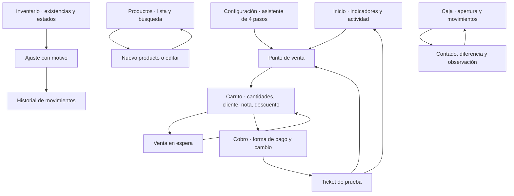

# Estructura y recorridos de pantallas

**Fase 01 · Diseño navegable, datos ficticios.** El archivo [POINT-Prototipo.html](../../../prototypes/phase-01/POINT-Prototipo.html) materializa estos esquemas.

## Mapa de navegación



La navegación permite entrar directamente en cada área. Cambiar de área conserva el carrito de ejemplo. No se necesita una cuenta real.

## POS en escritorio y tableta

```text
┌───────────────┬────────────────────────────────────────────────┐
│ POINT         │ Sucursal / estado de caja / ayuda              │
│ Negocio       ├────────────────────────────────────────────────┤
│               │ Aviso visible de prototipo y datos de ejemplo   │
│ Inicio        ├──────────────────────────────┬─────────────────┤
│ Punto de venta│ Título / ventas en espera    │ Venta actual    │
│ Productos     │ Buscar o escanear            │ Cliente         │
│ Inventario    │ Categorías / favoritos       │ Líneas          │
│ Caja          │                              │ Cantidades      │
│               │ Tarjetas de productos        │                 │
│ Configuración │ Nombre / precio / existencia │ Descuento/nota  │
│ Ayuda         │                              │ Total / COBRAR  │
└───────────────┴──────────────────────────────┴─────────────────┘
```

Buscar por nombre filtra; SKU/código exacto y Enter agregan una pieza. Los botones +/− cambian cantidades y validan las existencias de ejemplo. Una venta en espera conserva carrito/cliente/descuento/nota sin descontar stock.

## POS en móvil

```text
┌─────────────────────────────────┐
│ Menú / pantalla / caja           │
│ Prototipo / guía                 │
├─────────────────────────────────┤
│ Buscar o escanear                │
│ Categorías con desplazamiento    │
│ ┌─────────────┐ ┌─────────────┐  │
│ │ Producto    │ │ Producto    │  │
│ │ Precio / +  │ │ Precio / +  │  │
│ └─────────────┘ └─────────────┘  │
│                                 │
│ [Ver venta · unidades · total]   │
├─────────────────────────────────┤
│ Inicio Vender Productos Stock Caja│
└─────────────────────────────────┘
```

Ver venta abre el carrito. Cobrar abre una ventana de una columna. El teclado, Escape y los botones de cierre permiten regresar al recorrido.

## Cobro y ticket

En escritorio: resumen a la izquierda y método/recibido/cambio a la derecha. En móvil: resumen compacto y formulario vertical. Efectivo insuficiente muestra cuánto falta y bloquea confirmar. Terminal/transferencia explican que la versión funcional registrará un pago hecho externamente.

Confirmar una venta de prueba crea un ticket marcado como ejemplo sin validez fiscal; actualiza únicamente el estado local de la demostración. Imprimir usa el diálogo normal del navegador. Reabrir un ticket conserva su folio de prueba.

## Catálogo y producto

Lista con búsqueda, SKU, categoría, precio, disponibilidad y editar. Nuevo/editar muestra nombre, SKU, tipo, categoría, precio final, código y descripción. Un producto nuevo empieza con existencia cero; un servicio no usa inventario. Se muestran errores por SKU/código duplicado o precio inválido.

## Inventario

Indicadores de unidades/stock bajo/agotados/movimientos y tabla de productos físicos. Ajustar permite entrada/salida con cantidad y motivo. Historial muestra los cambios de ejemplo y la existencia posterior. No se representa aún el conteo, transferencia o Kardex de producción de la Fase 05.

## Caja

Panel de efectivo esperado, fondo inicial, ventas en efectivo y movimientos del turno. Entrada/retiro requieren importe y motivo. Corte compara esperado con contado y requiere observación cuando hay diferencia. Reabrir un turno no vuelve a sumar las ventas del turno anterior.

## Inicio

Resumen calculado desde las ventas de prueba: ventas, tickets, ticket promedio y productos por revisar. La actividad reciente permite abrir tickets. No se inventan cifras de ventas de producción ni tendencias de crecimiento.

## Configuración inicial

Cuatro pasos: negocio, sucursal, preferencias informativas y acceso al POS. Los nombres se presentan como ejemplos; no se pide contraseña, datos fiscales reales ni se aceptan términos. Este recorrido visual no sustituye el registro/onboarding real de la Fase 03.
