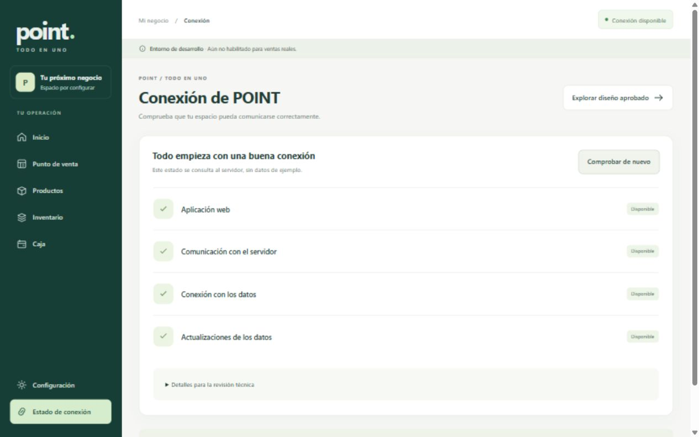
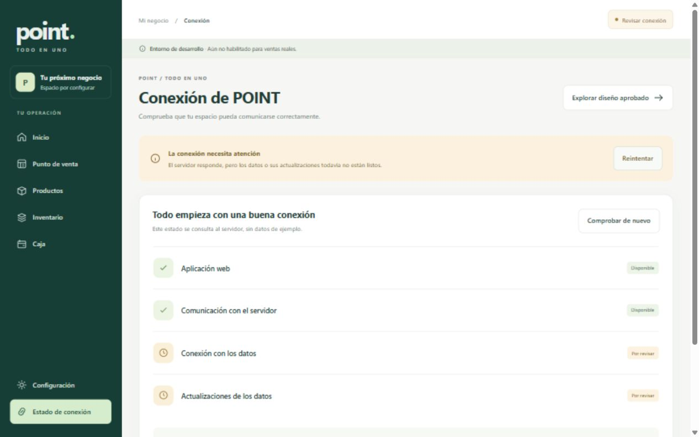
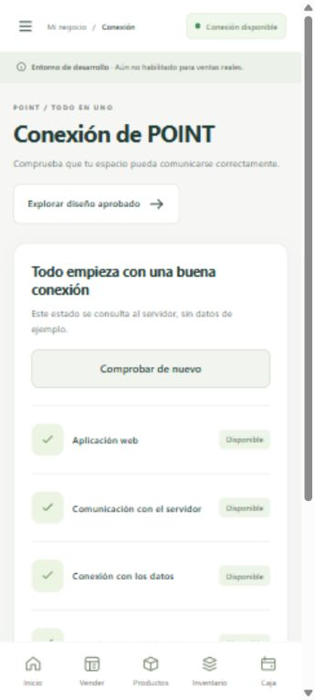

# Tercera parte para revisar · Fase 02

**Entrega:** base técnica ejecutable de POINT · versión 0.2.0.

**Estado:** lista para revisión, comprobada localmente y con contenedores en GitHub Actions. Diseño aprobado el 28 de octubre de 2026. La Fase 03 no ha comenzado.

**Actualización del 30 de octubre:** la base ya está compartida en [GitHub](https://github.com/MrG0N3R/pointcase). A la evidencia local del día 28 se suma la [ejecución remota aprobada](https://github.com/MrG0N3R/pointcase/actions/runs/41124362283) del commit `b9fc4ab`: instalación limpia, contratos, compilación, contenedores, pruebas y disponibilidad HTTP. La publicación no constituye aprobación de fase ni despliegue comercial.

## 1. Resumen

Se creó la aplicación React/TypeScript, un servidor FastAPI modular y PostgreSQL de desarrollo separado de las bases existentes. La aplicación consulta una conexión real, detecta si faltan actualizaciones de datos y muestra errores recuperables. Se conservó el prototipo aprobado como referencia independiente.

Esta entrega prepara el sistema. Todavía no permite crear cuentas de comercios, cargar un catálogo real ni cobrar ventas; esas funciones conservan sus próximas fases.

## 2. Arquitectura

- `apps/web`: aplicación web, navegación, estados de carga/conexión y configuración visual aprobada.
- `apps/api`: servidor modular, configuración validada, errores, registros y módulos system/jobs.
- `packages/shared`: tipos TypeScript generados desde el OpenAPI real.
- `infrastructure`: preparación local, migraciones, respaldo/restauración, Docker/Compose y Nginx.
- Repositorio Git compartido en `MrG0N3R/pointcase`, rama `main`, con guía para colaboradores y comprobaciones en cada push/pull request.

Los parámetros de instalación (idioma, moneda, zona, orígenes y conexiones) se leen de configuración. Los parámetros por cliente se incorporarán con empresas y permisos; no se usa una configuración global como sustituto del aislamiento SaaS.

## 3. Base de datos

PostgreSQL 18.3 en un clúster propio dentro de `.local/postgres/data`, puerto 55432 en 127.0.0.1. El asistente verifica la ruta del clúster antes de administrar bases. No usa el servicio PostgreSQL existente del equipo.

- `point_dev`: desarrollo.
- `point_test`: pruebas aisladas.
- Bases `point_backup_*` y `point_restore_*`: evidencia de recuperación con un registro ficticio; no contienen operaciones de un comercio.
- Migración `20261028_0001`: tabla `outbox_events`, unicidad por empresa/operación, estados e índice de eventos pendientes. Alembic mantiene su tabla de revisión.
- La cola es una base interna transaccional, sin API pública ni envío de mensajes. La relación con tenants reales y su llave foránea se añade en 03; no hay operaciones reales de clientes todavía.

## 4. Backend

| Ruta implementada | Resultado |
| --- | --- |
| `GET /health/live` | El servidor está vivo, incluso si PostgreSQL no está disponible |
| `GET /health/ready` | 200 cuando base y migraciones están listas; 503 si falta alguna |
| `GET /api/v1/system/status` | Estado real consultado desde la aplicación |
| `GET /api/v1/meta` | Nombre/versión y valores públicos de idioma, moneda y zona; sin secretos |
| `GET /api/v1/openapi.json` y `/api/docs` | Contrato y documentación en desarrollo; deshabilitados en producción |

Cada solicitud recibe `X-Request-ID`. Los errores tienen estructura consistente. Los registros JSON excluyen cuerpos, contraseñas, consultas y textos de errores internos.

## 5. Frontend

La navegación conserva los colores y la estructura aprobados. Inicio presenta los próximos pasos del negocio; Estado de conexión comprueba aplicación, servidor, datos y migraciones. Las demás áreas muestran su estado pendiente explícitamente. El diseño anterior está disponible mediante Explorar diseño aprobado y mantiene sus datos ficticios separados.

Las respuestas tipadas se generan desde [OpenAPI](../../api/openapi.json), con comandos que detectan contratos desactualizados. No se conecta una venta simulada del diseño con la base real.

## 6. Seguridad

Credenciales locales aleatorias en `.env` ignorado por Git; usuario de aplicación PostgreSQL sin privilegio de superusuario; puertos nativos y publicados por Compose limitados al equipo; CORS explícito, entradas de configuración validadas y errores sanitizados. Web/API de contenedor se configuran para usuarios sin root.

Autenticación, permisos, membresías, auditoría comercial y aislamiento de acceso SaaS siguen en 03 y cada módulo posterior. No publicar este entorno de desarrollo como producto comercial.

## 7. Pruebas y evidencia

| Comprobación | Resultado observado |
| --- | --- |
| Instalación Python limpia desde versiones fijadas | Correcta, en un segundo entorno aislado |
| Servidor + PostgreSQL | **16 pruebas aprobadas**, cero fallos; [reporte XML](evidence/tests.xml) |
| Migraciones | Upgrade/downgrade/upgrade probado en un esquema desechable; sin diferencias pendientes entre modelo y migración |
| Rollback y outbox | Un evento revertido no persiste; clave repetida se rechaza dentro de la misma empresa; otra empresa puede usar esa clave |
| Configuración | Valores públicos configurables; se rechazan orígenes abiertos, conexión incorrecta y zona inválida |
| Errores y registros | Correlación, 404, validación y error interno sin filtrar entradas sensibles; documentación deshabilitada en producción |
| Empaquetado del servidor | Importación comprobada fuera del árbol del repositorio, con la estructura que necesita un contenedor |
| Aplicación web | Compilación y comprobación TypeScript correctas |
| HTTP y proxy web | HTML, metadatos y conexión real responden correctamente |
| Interrupción de PostgreSQL | Live 200; ready 503; aviso visible; recuperación posterior a 200 conservando datos |
| Respaldo y restauración | Un registro ficticio se conservó en una base nueva; [evidencia](evidence/backup-restore.json) |
| Pantalla adaptable | Escritorio y móvil revisados; navegación móvil sin desbordamiento horizontal de página |
| Docker / CI | Construcción, arranque, pruebas y disponibilidad HTTP **aprobados en GitHub Actions el 30 de octubre**; Docker no instalado en este equipo Windows |

Se verificaron además enlaces locales, sintaxis YAML y rutas de archivos de Compose, conservación del maestro/prototipo e inexistencia de contraseñas locales en los archivos versionables y el paquete web. [Reporte de integridad](evidence/project-checks.json). La validación YAML no equivale a una ejecución de Docker.

La dependencia de pruebas emite una advertencia de deprecación sobre httpx/TestClient; no afecta los 16 resultados. Se conserva el conjunto fijado y comprobado, sin ocultar la advertencia.

## 8. Cómo revisar

En este equipo el entorno ya está preparado:

1. Hacer doble clic en [Iniciar POINT.cmd](../../../Iniciar%20POINT.cmd) desde la carpeta del proyecto. La ventana inicia la base propia, aplica migraciones pendientes y arranca web/API.
2. Abrir [POINT local](http://127.0.0.1:5173/) y entrar en Estado de conexión. Todos los servicios deben aparecer disponibles.
3. Recorrer las áreas y comprobar que se distingue lo pendiente del diseño de ejemplo.
4. Revisar las instrucciones completas de [ejecución y recuperación](../../../DEPLOYMENT.md).

Al terminar, Ctrl+C detiene web/API. Para detener la base propia, ejecutar `local.py stop` como indica la guía. Los datos se conservan. La vista previa usada para comprobar esta entrega no se instala como servicio del sistema.

## 9. Criterios de aceptación

- [x] Diseño aprobado y conservado como referencia.
- [x] Web, API modular, PostgreSQL y primera migración ejecutables.
- [x] Valores locales separados del código y sin secretos en archivos rastreables.
- [x] Comprobaciones de estado, errores consistentes y registros sanitizados.
- [x] OpenAPI y tipos compartidos generados/verificables.
- [x] Pruebas relevantes con PostgreSQL real y una instalación limpia.
- [x] Respaldo/restauración independiente con datos de prueba verificados.
- [x] Arranque local, documentación y cambios registrados.
- [x] Dockerfiles, Compose, Nginx y flujo CI definidos.
- [x] Construcción y ejecución real de contenedores en Linux mediante GitHub Actions.
- [ ] Usuario revisó esta entrega y confirmó avanzar.

## 10. Pendientes

La revisión del usuario sigue pendiente. El recorrido Docker ya está comprobado en CI; no se ha instalado un motor Docker en este equipo Windows. Las bases nativas y el volumen Docker son almacenes independientes.

Después de revisar esta base y acordar continuar: **Fase 03, acceso, empresas, sucursales y permisos**, incluidos los controles y pruebas de separación de información entre clientes. Los parámetros particulares del negocio se ajustarán progresivamente como solicitó el usuario.

